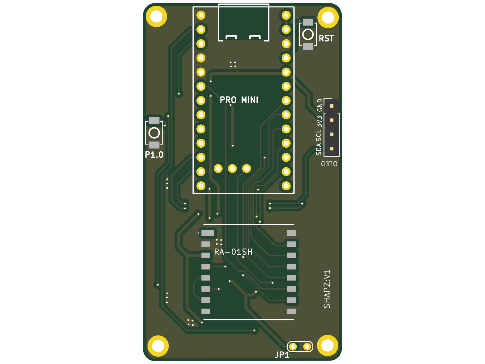
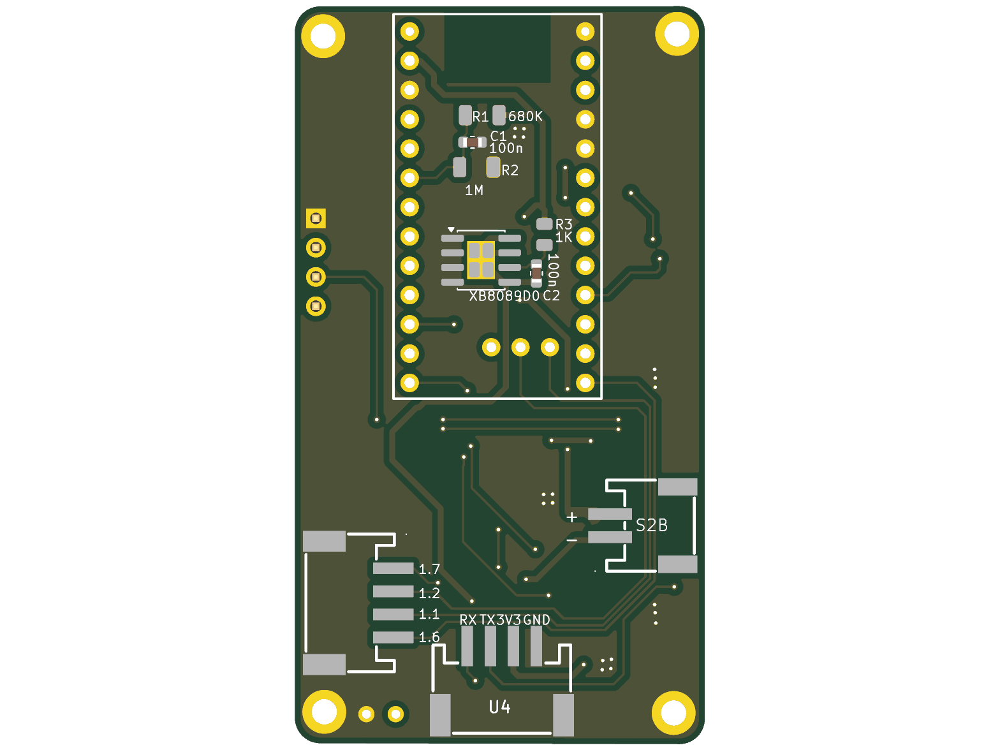

# Meshtastic Node — Hardware Prototype

Based on **[Faketec](https://github.com/gargomoma/fakeTec_pcb)**, an open-source Meshtastic hardware board by **gargomoma**. This KiCad hardware project uses an nRF52840 Pro Micro-style controller and an RA-01SH LoRa module. This repository collects the schematic, PCB layout, board images, and prototype troubleshooting notes.

**Status: prototype under development.** Assembly and continuity troubleshooting are documented; end-to-end radio operation, charging performance, and battery protection have not been established by the available test record. This is not a validated production design.

## Board overview

The design includes:

- A Pro Micro-style controller footprint labelled `nice!nano_v2`; the project discussion identifies the fitted controller as a Nologo nRF52840 Pro Micro module. Verify the actual module pinout and specifications before assembly.
- An RA-01SH LoRa radio module.
- An XB8089D0 single-cell battery-protection circuit.
- Battery and auxiliary connectors, push buttons, and mounting holes.

## Repository contents

| Folder | Contents |
|---|---|
| `hardware/` | Editable KiCad project, schematic, PCB, and extracted custom footprints |
| `images/` | Existing PCB top and bottom images |
| `docs/` | Test status, known issues, and provenance notes |

## Open the design

Open `hardware/meshtastic-node.kicad_pro` in KiCad. The PCB was successfully parsed using KiCad 10.0.8 during repository preparation. Custom footprints were extracted from the PCB and supplied with project-relative library paths. Schematic symbols are embedded in the schematic; original external symbol libraries are not included. External 3D models may be unavailable.

Before ordering boards, review the schematic and footprints, run electrical and design-rule checks, verify manufacturer constraints, and resolve the known battery-protection issue. Manufacturing outputs are not included as a verified release.

## Current testing status

The assembled prototype has been investigated using continuity checks around the battery-negative and protection circuitry. A possible solder-joint fault was discussed, but the cause has not been conclusively established. A temporary protection bypass was discussed for maintenance; this does not demonstrate correct protection operation.

See [testing and known issues](docs/TESTING.md) for what remains to be measured.

## Firmware

Meshtastic firmware is a separate upstream project: https://github.com/meshtastic/firmware

The local project contains firmware downloads for multiple board targets. Those binaries are intentionally excluded here because their presence does not establish compatibility with this PCB. Confirm the controller, radio variant, wiring, and firmware target before flashing.

## Provenance and attribution

The starting design files were collected from the `meshtastic` folder in [Paulshapwala/kicad-pcb-1](https://github.com/Paulshapwala/kicad-pcb-1/tree/master/meshtastic). This repository is a standalone snapshot, not a preservation of the original commit history.

Footprint library identifiers include `faketec` and `easyeda2kicad`. Their identifiers alone do not establish the original creators or license terms. The base hardware design is credited to Faketec by gargomoma. The exact upstream revision, any additional third-party sources, and this project's specific modifications still need to be documented. See [provenance notes](docs/PROVENANCE.md).

This is an independent hardware project; it is not an official Meshtastic product. No new license is assigned in this snapshot pending a review of the source design and third-party assets.
